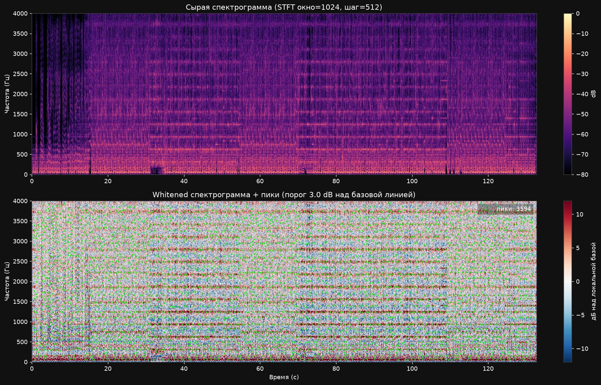
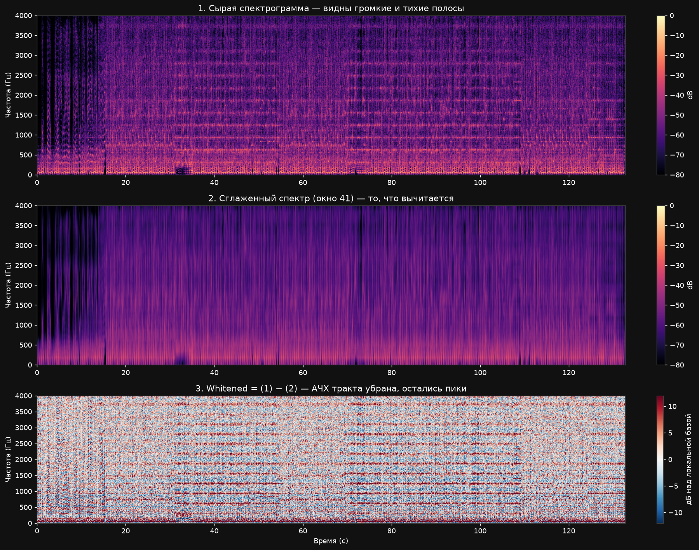
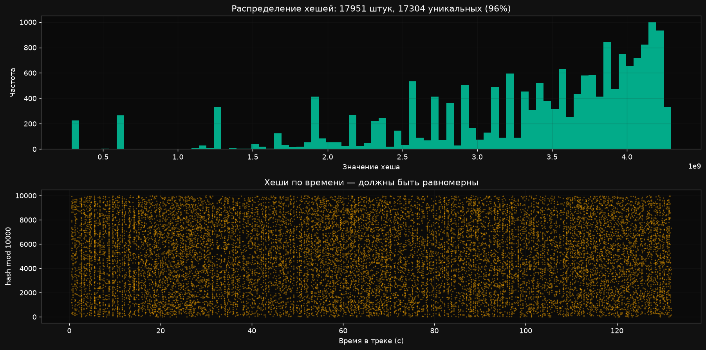
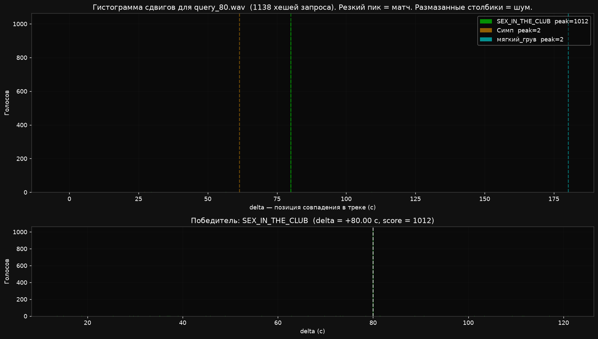

# auricle-core

**Ядро аудио-фингерпринтинга для распознавания музыки.**
Работает как Shazam, но полностью локально. Без ML-моделей, без внешних API.

[](https://www.python.org/)
[](https://www.gnu.org/licenses/agpl-3.0)
[](#)

## Что это

`auricle-core` — библиотека и набор инструментов для распознавания музыки по короткому отрывку. Вы даёте 10 секунд аудио - получаете название трека, позицию в нём и оценку уверенности.

Проект построен как переиспользуемое ядро:

- `auricle/` - движок: fingerprinting, индекс, матчер, фасад `Engine`.
- `cli.py` - командная строка для индексации и поиска.
- `live.py` - live-детектор: слушает микрофон или loopback и ведёт таймлайн.
- `visualize.py` - генерация графиков для отладки и документации.

Вокруг ядра можно построить что угодно: веб-сервис, телеграм-бота, десктопное приложение. Ядро не знает, откуда приходит аудио - из файла, микрофона, сетевого потока.

## Возможности

- **Точность 99.8% top-1** на собственной базе из 128 треков.
- **Устойчивость** к MP3 32 kbps, шуму, реверберации, полосовым фильтрам.
- **Live-режим**: непрерывный мониторинг потока с определением смены трека.
- **Многопоточная индексация** через `multiprocessing` - 128 треков за ~70 сек.
- **Чистый NumPy/SciPy** - никаких нейросетей, минимальные зависимости.
- **SQLite-хранилище**

## Как это работает

### Идея в одном абзаце

Звук превращается в набор пиков на спектрограмме. Каждый пик связывается с несколькими следующими - получается «созвездие» из пар точек. Пара кодируется в 32-битный хеш: две частоты, разница во времени и магнитуды. Хеши всех треков складываются в базу. При поиске хеши запроса ищутся в базе, и если трек совпал - все совпадения дают одинаковый сдвиг по времени. Этот сдвиг образует резкий пик на гистограмме, что и подтверждает матч.

### Технические детали пайплайна

**1. Оцифровка и ресемплинг.** Звук приходит как массив амплитуд (стерео, 44100 Гц). Усредняем в моно и ресемплим в 8000 Гц. Полоса 0–4000 Гц содержит всю нужную для распознавания информацию, а объём данных падает в 5.5 раз.

**2. STFT - переход к частотам.** Сигнал режется на окна по 1024 сэмпла (128 мс), соседние окна перекрываются на 50%. К каждому применяется окно Ханна (сглаживание краёв, чтобы избежать утечки спектра), затем FFT. Результат - спектрограмма `S[f, t]`: громкость на каждой частоте в каждый момент.

**3. Spectral whitening.** Разные тракты (студия, микрофон, колонки) имеют разную АЧХ - одни частоты поднимают, другие глушат. Для устойчивости вычитаем из спектра его же сглаженную по частоте версию: `S_whiten[f, t] = S[f, t] - smooth(S[:, t])`. Локальные пики остаются, общий фон уходит.

**4. Детекция пиков.** Ищем локальные максимумы на спектрограмме: точка должна быть больше всех соседей в окне 15x15 и выше локальной базовой линии на 3 дБ. Это «звёзды на небе» — их у трека 3000–32000.

**5. Лог-частотные бины.** Точная частота пика нестабильна - сжатие и шум её сдвигают. Квантуем в 256 логарифмических бинов (8 бит). Логарифм совпадает с восприятием уха и даёт равномерное разрешение.

**6. Пары пиков в хеши.** Одиночный пик повторяется в тысячах песен. Пара пиков с известным временным расстоянием - почти уникальна. Для каждого пика берём до 5 «целей» в следующие ~4 секунды, кодируем в 32-битный хеш: `f1(8) | f2(8) | dt(8) | mag1(4) | mag2(4)`.

**7. Индекс.** Все хеши сохраняются в SQLite с полями `(hash, track_id, offset)`. B-tree индекс по хешу - поиск за O(log N).

**8. Поиск через голосование по delta.** Для каждого хеша запроса находим все совпадения в базе. Для каждого считаем `delta = db_offset - query_offset`. Если запрос - фрагмент трека X, все delta будут одинаковы. Строим гистограмму delta для каждого трека - правильный даёт резкий пик, случайные совпадения размазаны по всей оси.

**9. Live-режим.** Скользящее окно 10 сек с шагом 2 сек. State machine отслеживает delta: при непрерывном воспроизведении она растёт линейно. Резкий скачок означает смену трека, повтор или перемотку. Несколько пустых окон подряд означает, что трек закончился.

### Полный пайплайн

```
WAV/FLAC/MP3
    |
    |  load_audio(): моно, ресемплинг в 8 kHz, нормализация
    v
одномерный сигнал (float32, 8000 Гц)
    |
    |  STFT: окно 1024, шаг 512, окно Ханна
    v
спектрограмма S[f, t] в дБ
    |
    |  spectral whitening: вычитаем сглаженный по частоте спектр
    v
нормализованная спектрограмма (убрана АЧХ тракта)
    |
    |  find_peaks(): локальные максимумы в окне 15x15
    v
набор пиков (t, f) — созвездие
    |
    |  лог-частотные бины: 256 бинов по лог-шкале
    |  квантование магнитуды в 16 уровней
    v
хеши: (f1_log<<24) | (f2_log<<16) | (dt<<8) | (mag1<<4) | mag2
    |
    v
SQLite: (hash, track_id, offset)
```

При поиске:

```
запрос -> те же хеши -> SELECT по индексу -> голосование по delta
    |
    |  delta = db_offset - query_offset
    |  для правильного трека все delta одинаковы -> пик на гистограмме
    v
Match(track_id, title, score, delta, coverage)
```

## Установка

### Требования

- Python 3.10+
- `libsndfile` (для чтения WAV/FLAC)
- (Опционально) `ffmpeg` для нарезки тестовых фрагментов
- (Опционально) `sounddevice` для live-режима
- (Опционально) `matplotlib` для визуализации

### Шаги

```bash
git clone https://github.com/xcpvo/auricle-core.git
cd auricle-core

python -m venv .venv
.venv\Scripts\activate          # Windows
# source .venv/bin/activate     # macOS/Linux

pip install numpy scipy soundfile
pip install sounddevice         # для live-режима
pip install matplotlib          # для visualize.py
```

libsndfile:

- Windows: уже в wheel `soundfile`, ничего делать не надо.
- macOS: `brew install libsndfile`
- Debian/Ubuntu: `sudo apt install libsndfile1`

Для MP3 дополнительно нужен `libsndfile` версии 1.1 или выше. Если версия старая - проще конвертировать MP3 в WAV через `ffmpeg`:

```bash
ffmpeg -i song.mp3 -ar 44100 -ac 2 song.wav
```

## Быстрый старт

### 1. Подготовить аудио

Соберите WAV-файлы в папку `wav/`:

```
wav/
  Artist1 - Track A.wav
  Artist2 - Track B.wav
  Artist3 - Track C.wav
```

Каждый файл - минимум 30 секунд. Полные треки оптимальны.

### 2. Проиндексировать

```bash
python cli.py index-dir wav --workers 6
```

Что произойдёт: каждый файл читается, ресемплится, фингерпринтится. Хеши складываются в SQLite-базу `fingerprints.db`. Параллельно на 6 ядрах.

Ожидаемое время: около 70 секунд на 128 треков (Ryzen 5 5500, 6 воркеров). Размер базы: ~3.1M хешей, ~145 МБ.

### 3. Проверить базу

```bash
python cli.py list
```

### 4. Найти трек по отрывку

```bash
ffmpeg -i "wav\Artist1 - Track A.wav" -ss 40 -t 10 -ar 44100 -ac 2 query.wav
python cli.py query query.wav
```

Ожидаемый вывод:

```
Artist1 - Track A  score=585  coverage=53%  delta=+40.00с
```

Как читать результат:

| Поле | Значение |
|---|---|
| `title` | Название трека |
| `score` | Число совпавших хешей. 500+ - уверенный матч, 50-200 - вероятный, меньше 50 - слабый |
| `coverage` | Доля хешей запроса, нашедших пару. 80%+ - отлично, 20-50% - норма для интро |
| `delta` | Позиция начала запроса в треке. +40с = запрос начинается с 40-й секунды |

## Демонстрация

Полный разбор работы ядра на одном треке - **Heronwater, SEX IN THE CLUB** (132 секунды). Все графики сгенерированы командой `python visualize.py` на реальном аудио.

### Спектрограмма с пиками



Сверху - сырая спектрограмма. Снизу - после whitening с наложенными пиками (зелёные точки). 6431 пик стал источником хешей.

### Что делает spectral whitening



Три панели: сырой спектр, сглаженный, разница. Whitening убирает общую АЧХ и оставляет только локальные пики. Именно поэтому ядро не боится микрофона и разных колонок.

### Распределение хешей



Хеши равномерны и по значению, и по времени. Значит, пространство используется эффективно, коллизий мало.

### Гистограмма сдвигов



Для 10-секундного запроса из 80-й секунды трека. Резкий пик на delta = +80.00с - это момент совпадения. Все совпадения проголосовали за одну позицию. Score = 1012, coverage = 89%.

### Результаты запросов

```
$ python cli.py query query_40.wav
SEX_IN_THE_CLUB  score=585   coverage=53.0%  delta=+40.00с

$ python cli.py query query_80.wav
SEX_IN_THE_CLUB  score=1012  coverage=88.9%  delta=+80.00с
```

Delta совпадает с позицией обрезки с точностью до кадра.

### Тест точности

```
$ python test_accuracy.py
Top-1 accuracy: 520/521 = 99.8%
  OK:    520
  MISS:  1  (нет кандидатов)
  WRONG: 0   (нашёл не тот трек)
```

## Команды CLI

### Индексация

```bash
# Один или несколько файлов
python cli.py index file1.wav file2.wav

# Вся папка рекурсивно
python cli.py index-dir wav

# Только верхний уровень
python cli.py index-dir wav --flat

# Параллельно на 6 ядрах
python cli.py index-dir wav --workers 6

# Другие расширения
python cli.py index-dir wav --ext wav,flac

# Переиндексировать всё (после смены параметров)
python cli.py index-dir wav --no-skip-existing

# Ограничить первыми 5 файлами (для отладки)
python cli.py index-dir wav --limit 5

# Уникальные title для вложенных папок
python cli.py index-dir wav --prefix-subdir
```

### Поиск и управление

```bash
python cli.py query query.wav   # найти трек по отрывку
python cli.py list              # список треков в базе
python cli.py delete 5          # удалить трек по id
python cli.py --help            # полный список опций
```

## Live-режим

Слушает аудио-поток (микрофон, loopback, виртуальный кабель) и в реальном времени ведёт таймлайн.

### Список устройств

```bash
python live.py devices
```

Windows: `Microphone (Yeti Classic)` — микрофон, `CABLE Output` или `Voicemeeter Out B1` — loopback. Используйте WASAPI - у них минимальная задержка.

### Симуляция

```bash
python live.py simulate "wav\SEX_IN_THE_CLUB.wav"
python live.py simulate "wav\SEX_IN_THE_CLUB.wav" --realtime --debug
```

### Микрофон и loopback

```bash
python live.py listen --device 77 --debug   # микрофон
python live.py listen --device 73 --debug   # loopback через Voicemeeter
```


### Как читать вывод

```
[12:34:15]  START  Artist1 - Track A  score=312
[12:34:20]  END    Artist1 - Track A  duration=5.3s
[12:34:23]  START  Artist2 - Track B  score=287
```

START - трек подтверждён. END - трек закончился (после `MAX_MISSES` пустых окон).

### Пороги

| Параметр | По умолчанию | Что означает |
|---|---|---|
| `MIN_SCORE_START` | 25 | Порог для мгновенного старта |
| `MIN_SCORE_HISTORY` | 8 | Минимум для попадания в историю |
| `MIN_CONSECUTIVE` | 3 | Сколько окон подряд для старта по истории |
| `MAX_MISSES` | 4 | Сколько пустых окон = трек закончился |
| `WINDOW_SEC` / `HOP_SEC` | 10 / 2 | Размер окна и шаг |

Для чистого loopback: `MIN_SCORE_START=50`. Для шумного микрофона: `MIN_SCORE_START=15`.

## Визуализация

```bash
pip install matplotlib

python visualize.py spectrogram "wav\track.wav" --save spec.png
python visualize.py whiten      "wav\track.wav" --save whiten.png
python visualize.py hashes      "wav\track.wav" --save hashes.png
python visualize.py delta query.wav --save delta.png
python visualize.py all "wav\track.wav" --save out
```

Графики:

- `waveform` — сырая форма волны.
- `spectrogram` — пики на спектрограмме в виде точек.
- `whiten` — три панели: сырой спектр, сглаженный, разница.
- `delta` — гистограмма сдвигов для запроса. Самая важная картинка.
- `hashes` — распределение хешей по значениям и времени.

## Архитектура

```
+---------------------------------------------+
|  cli.py    live.py    visualize.py   (UI)   |   <- обвязки
+---------------------------------------------+
|                  Engine                     |   <- фасад
+----------+---------------+---------------+--+
| Finger-  |     Index     |     Matcher      |   <- ядро
| printer  |   (SQLite)    |                  |
+----------+---------------+---------------+--+
|              Config (dataclass)             |   <- параметры
+---------------------------------------------+
```

Ключевое правило: слои не знают друг о друге. `Fingerprinter` не знает про SQLite. `Matcher` не знает про файлы. `Engine` собирает всё вместе. Это позволяет заменить SQLite на MongoDB или LMDB без изменений в алгоритме.


## Использование как библиотеки

```python
from auricle import Engine, Config

cfg = Config(target_sr=8000, min_score=10, top_k=5)

with Engine('library.db', cfg) as eng:
    eng.add_file('Artist - Title', 'song.wav')
    eng.add_samples('Another - Track', numpy_array)
    print(eng.stats())

    matches = eng.search_file('query.wav')
    for m in matches:
        print(f'{m.title}  score={m.score}  delta={m.delta}')
```

Работа с сырым буфером (для live):

```python
with Engine('library.db') as eng:
    y = np.frombuffer(raw_bytes, dtype=np.float32)  # 8 kHz, моно
    matches = eng.search_samples(y)
```

Доступ к нижним слоям:

```python
from auricle import Fingerprinter, Config

fp = Fingerprinter(Config())
hashes = fp.from_samples(y)
S = fp.spectrogram(y)
times, freqs = fp.peaks(y)
```

## Параметры

Все параметры — в `auricle/config.py`, dataclass `Config`.

| Параметр | Значение | Смысл |
|---|---|---|
| `target_sr` | 8000 | Частота дискретизации (Гц) |
| `n_fft` | 1024 | Размер окна STFT |
| `hop` | 512 | Шаг между окнами (перекрытие 50%) |
| `window` | hann | Оконная функция |
| `peak_neighborhood` | 15 | Окно поиска локальных максимумов |
| `peak_threshold_db` | -50.0 | Абсолютный порог пиков (при whiten=False) |
| `whiten` | True | Включить spectral whitening |
| `whiten_threshold_db` | 3.0 | Порог пика над базовой линией |
| `whiten_window` | 41 | Окно сглаживания по частоте |
| `log_f_min` / `log_f_max` | 40 / 4000 | Диапазон лог-частот (Гц) |
| `log_n_bins` | 256 | Число лог-частотных бинов |
| `dt_min` / `dt_max` | 1 / 63 | Разброс пар пиков по времени |
| `max_targets` | 5 | Целей на каждый якорь |
| `mag_n_buckets` | 16 | Уровней квантования магнитуды |
| `min_score` | 5 | Минимальный score в матчере |
| `top_k` | 50 | Сколько кандидатов возвращать |

### Когда менять

Точность упала - опустите `whiten_threshold_db` до 2.5 или `peak_neighborhood` до 11.

Много ложных - поднимите `whiten_threshold_db` до 4.0 или `min_score` до 20.

База растёт, коллизии - увеличьте `log_n_bins` до 512 и `dt_max` до 127. Потребует переиндексации.

Быстрее индексировать - опустите `max_targets` до 3.

**Важно:** если поменяли формулу хеша (`dt_min`, `dt_max`, `log_n_bins`, `mag_n_buckets`) - удалите базу и переиндексируйте.

## Тесты и метрики

### Точность

```bash
python test_accuracy.py
```

Режет каждый WAV на 10-секундные фрагменты с шагом 10 секунд. Ожидаемый результат на 128 треках: 99.8%, 0 WRONG.

MISS обычно на тихих интро, коротких скитах (меньше 15 сек), участках с минимумом музыки. Это свойство fingerprinting.

### Устойчивость

```bash
python test_robustness.py
```

15 сценариев деградации звука: MP3 32/64/128 kbps, lowpass, highpass, bandpass, шум 3 уровней, реверберация, клиппинг, pitch shift, tempo stretch, radio-like.

Ожидаемые провалы: `pitch_*` (0-2%) и иногда `noise_heavy`. Всё остальное - 95%+.

Pitch shift ломает распознавание: сдвиг тона меняет все частоты, хеши не совпадают. Shazam тоже ломается на pitch больше 1%. Это ограничение классического fingerprinting.

## Известные ограничения

**Pitch shift.** Транспонированный трек (+/- 2%) не найдётся. Для каверов и кассетных записей не работает.

**Тихие участки.** Интро, аутро, паузы, скиты - мало пиков, матчей нет. В live это неважно: трек определится, как только пойдёт музыка. Интуитивно кажется багом: запрос с 15-й секунды не находится, а с 40-й находится. Причина - на 15-й секунде тихое интро, а на 40-й припев.

**SQLite-запись.** Узкое место при индексации. Для 10 000+ треков нужно менять storage (LMDB, RocksDB, in-memory).

**Память растёт линейно.** Примерно 1 МБ на трек в базе. Для 100k треков - около 100 ГБ.

**Размер базы.** 128 треков = 145 МБ. Причина - 32-битные хеши и 4-битные магнитуды.

## Советы

### Индексация

- Полные треки, а не отрывки. 30 секунд хватит для теста, но при поиске в непроиндексированном месте ядро не найдёт ничего.
- Параллельность - включайте. `--workers 6` даёт 2x на 128 треках.
- Уникальные title. Для `Disc1/01.wav` и `Disc2/01.wav` используйте `--prefix-subdir`.
- Избегайте дубликатов. Одна песня в двух файлах не ломает поиск, но выдает MISS на тестах.

### Live-режим

- `--debug` всегда сначала. Если `rms` меньше 0.01 — микрофон не слышит.
- Пороги под контент. Для чистого loopback `MIN_SCORE_START=50`, для шумного микрофона — 15.

### Отладка

- Сначала `simulate`, потом `listen --debug`.
- `visualize.py delta` - если что-то не находится.
- Проверяйте delta: для правильного матча она растёт на `HOP_SEC` каждый шаг.

## Благодарности

Алгоритм основан на классической работе:

> Avery Li-Chun Wang. **An Industrial-Strength Audio Search Algorithm.** ISMIR 2003.

---

**Сделано с уважением к Shazam и его авторам.**
